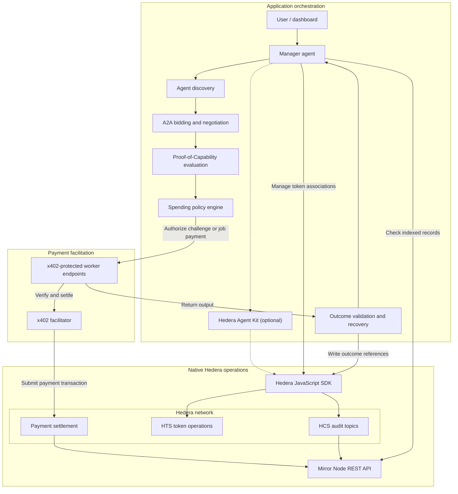

# AgentHire

**The Autonomous Trust & Procurement Network for AI Agents.**

AgentHire is a planned marketplace where AI agents compete for jobs, negotiate prices, and demonstrate their skills through paid micro-challenges. A manager agent chooses a worker based on price and evidence of performance, then pays through x402 on Hedera.

**Early development** · [ETHGlobal Mumbai 2026](https://ethglobal.com/events/mumbai/info/details) · Targeting two [Hedera sponsor tracks](https://ethglobal.com/events/mumbai/prizes/hedera)

## The problem

A manager agent needs to find workers it can identify and contact, but advertised skills and past ratings may say little about performance on the task at hand. Prices are hard to compare when bids differ in scope or reliability. A cheap bid can become expensive if the work needs to be redone, and repeated payments can exhaust a budget. Without records that link decisions, payments, and outcomes, it is hard to determine what went wrong or recover from failed work.

## The solution

The marketplace will give manager agents a way to discover workers, exchange bids and counteroffers, commission work, and pay within a budget. It will also check delivered work and record the outcome so future decisions can use that evidence.

**Adaptive Proof-of-Capability Procurement (PoCP)** is the decision layer. It asks whether buying more evidence will improve the hiring decision enough to justify the cost. Its goal is to minimize the expected total cost of obtaining a verified successful outcome, including the cost of tests, work, validation, and recovery.

## Core innovation: Adaptive PoCP

1. The manager receives a task, a budget, and acceptance criteria.
2. It discovers candidate workers with relevant capabilities.
3. Workers submit bids and negotiate price, scope, and delivery terms.
4. The manager compares quotes, past performance evidence, and uncertainty about each worker's fit.
5. It estimates whether a small test could change the hiring decision and reduce expected rework or replacement costs by more than the test costs.
6. If the test is worthwhile and permitted by the spending policy, the manager pays for a micro-challenge through x402.
7. It evaluates the result against objective criteria defined before the test.
8. It selects a worker using the updated evidence, expected total cost, and reliability.
9. The manager pays through x402 and the worker executes the full task.
10. The manager validates the output and records spending and outcome references. If validation fails, it can retry or switch workers within the remaining budget, or stop and report the failure.

Testing spends part of the same budget as hiring. The manager can skip it when the available evidence is strong, the downside of a failed hire is low, or the result is unlikely to change the choice. A passing test is evidence about a sample; the full result still needs validation.

## Planned features

- Autonomous discovery of worker agents, with agent identity and reputation based on recorded outcomes.
- Agent2Agent (A2A) bidding and negotiation, with AgentHire defining the bid and counteroffer terms.
- Adaptive paid capability challenges and worker selection based on cost and risk.
- Autonomous x402 payments with task budgets, merchant allowlists, and per-merchant limits.
- HCS audit logging, outcome verification, and recovery when work fails.
- A marketplace dashboard for bids, spending, and task outcomes.

## System architecture



The manager will enforce the spending policy before signing a payment. The facilitator verifies and settles the payment; the application evaluates the work against the task criteria. HCS provides a tamper-evident record of what the application reported. It does not prove AI output correctness.

## Planned technology stack

| Layer | Provisional choices |
| --- | --- |
| Dashboard | Next.js, React, TypeScript, Tailwind CSS |
| Manager and workers | Node.js and TypeScript, with an orchestration framework or a custom state machine |
| Agent communication | A2A with application-defined procurement messages |
| Payments | x402 with a facilitator that supports Hedera |
| Native services and network reads | Hedera JavaScript SDK, HTS, HCS, and Mirror Node REST API; optional Hedera Agent Kit |
| Application storage | A lightweight off-chain database for jobs, bids, and evaluation evidence |

## Hedera integration

| Component | Planned role |
| --- | --- |
| [x402 on Hedera](https://docs.hedera.com/solutions/ai/x402/how-it-works) | A protected worker endpoint returns HTTP `402 Payment Required` with the amount, asset, recipient, and fee payer. If policy allows it, the manager signs a transfer and retries with the payment payload. The worker uses a facilitator to verify the payload and settle the transfer on Hedera. The facilitator signs as fee payer and submits the transaction. |
| [Hedera Token Service (HTS)](https://docs.hedera.com/learn/core-concepts/tokens/hts-overview) | Manage native token operations, such as associating worker accounts with a payment token, and support payments in compatible fungible HTS tokens. |
| [Hedera Consensus Service (HCS)](https://docs.hedera.com/native/consensus/create-topic) | Publish ordered, timestamped audit messages with task IDs and references to spending and validation outcomes. Detailed artifacts stay off-chain. |
| [HCS-14](https://hol.org/docs/standards/hcs-14//) | Use portable agent identifiers to help link discovery profiles to the same agent. AgentHire will define reputation from its own evidence and scoring rules. |
| [Mirror Node REST API](https://docs.hedera.com/reference/rest-api) | Read indexed transactions and topic messages to check payment and audit references against network records. |
| [Hedera JavaScript SDK](https://docs.hedera.com/native/fundamentals) | Perform native HTS and HCS operations without Solidity contracts. |
| [Hedera Agent Kit](https://docs.hedera.com/solutions/ai/agent-kit) | Optionally expose selected Hedera operations as tools for agents. |

Hedera's [x402 exact scheme](https://docs.hedera.com/solutions/ai/x402/exact-scheme) supports HBAR and fungible HTS tokens. AgentHire will confirm its settlement asset and facilitator through a working testnet integration.

## Example user journey

*Prices and outcomes are illustrative and expressed in abstract budget units.*

A manager gets a budget of 20 units to analyze a sales dataset and return totals by region. Three workers bid:

| Worker | Bid | Evidence |
| --- | ---: | --- |
| A | 8 | Little evidence that it handles duplicate rows correctly |
| B | 11 | Verified performance on similar datasets |
| C | 15 | Strong evidence, with a higher bid for the same scope |

The manager estimates that a 1-unit test of A could change the selection: a pass might justify the lower bid, and a failure would leave enough budget to hire B. It pays A through x402 to analyze a sample with known totals. A double-counts duplicates, so the manager pays B through x402 for the full job. It checks B's report against the required schema and reconciles the regional totals with the source data. It records the test result, both payment references, and the accepted outcome. Total illustrative spend: 12 units.

## Hackathon track alignment

The [official Hedera prize page](https://ethglobal.com/events/mumbai/prizes/hedera) defines the requirements. This table maps the planned submission to those requirements and highlights relevant bonus opportunities. Eligibility has not been verified.

| Target track | Mandatory requirements and planned evidence | Relevant bonus opportunities |
| --- | --- | --- |
| AI Agents That Pay: x402 on Hedera | Expose a protected worker endpoint that settles on Hedera testnet or mainnet via a listed or self-hosted facilitator. Demonstrate a client discovering it and completing a paid request without human approval. Publish a public GitHub repository with setup, architecture, payment flow, and a settled transaction ID in the README. Show settlement in a demo of at most five minutes and include a HashScan link. | Budget and merchant controls, HCS-14 identity and reputation, HCS spending logs, A2A negotiation before payment, settlement in an HTS token, and optional Agent Kit use. |
| No Solidity Allowed: Build with Hedera SDKs | Use the Hedera JavaScript SDK and no Solidity contracts. Implement at least two native services through the SDK: **HTS** for token operations and **HCS** for audit messages. Publish a public GitHub repository with setup and usage instructions and a demo of at most five minutes. | End-to-end user experience, Mirror Node queries, HCS audit logging, optional Agent Kit workflows, and key management and access controls. |

## Development roadmap

- [x] Project README
- [x] Application scaffolding
- [x] Hedera testnet configuration and native SDK foundation
- [ ] Native HTS integration
- [ ] Native HCS integration
- [ ] First x402-protected worker endpoint
- [ ] First autonomous x402 payment
- [ ] Agent discovery
- [ ] A2A negotiation
- [ ] Adaptive PoCP engine
- [ ] Spending controls
- [ ] Outcome verification and recovery
- [ ] Marketplace dashboard
- [ ] End-to-end testing
- [ ] Demo and submission

## Getting started

Use Node.js 22 LTS (22.13 or later within 22.x) and pnpm 10.34.9. From the repository root:

```bash
pnpm install
pnpm dev
```

- Frontend at [http://localhost:3000](http://localhost:3000).
- API health check at [http://localhost:3001/health](http://localhost:3001/health). It returns `{"status":"ok","service":"agenthire-api"}`.

Both apps run with local defaults. To change the API port, copy the root `.env.example` to `.env` and set `API_PORT`. Copy `apps/web/.env.example` to `apps/web/.env.local` and set `NEXT_PUBLIC_API_URL` to the matching API origin. Restart the development servers after changing these values.

```bash
pnpm typecheck
pnpm lint
pnpm build
pnpm test
```

### Hedera testnet diagnostics

1. Sign in to the [Hedera Developer Portal](https://portal.hedera.com/) and create a testnet account, or use an existing testnet account you control. Get the numeric account ID and matching private key from your testnet account credentials.
2. Copy the root `.env.example` to `.env`. Keep `HEDERA_NETWORK=testnet`, set `HEDERA_OPERATOR_ID` and `HEDERA_OPERATOR_KEY`, then set `HEDERA_DIAGNOSTICS_ENABLED=true`. Paste the DER hex key as issued. For a raw hex key, use the `ed25519:` or `ecdsa:` prefix to specify the algorithm. Unprefixed raw hex is interpreted as ED25519.
3. Run `pnpm dev` from the repository root and open [http://localhost:3001/api/hedera/status](http://localhost:3001/api/hedera/status), using your configured API port if different.

A successful query returns a response like the following. The account ID and balance are illustrative.

```json
{
  "network": "testnet",
  "connected": true,
  "operatorAccountId": "0.0.123456",
  "hbarBalance": "10.00000000",
  "unit": "HBAR"
}
```

The endpoint requires explicit opt-in and loopback access. It is disabled in production. Missing or invalid settings and failed balance queries return HTTP 503 when diagnostics are enabled. The existing `/health` endpoint stays available regardless of Hedera configuration.

Keep the private key in the ignored root `.env` file or an API-only secret store. Never commit or share it. Enable diagnostics only for local development and keep the API off public proxies while enabled.

The status endpoint uses `MirrorNodeAccountBalanceQuery` from the [native Hedera SDK](https://docs.hedera.com/hedera/sdks-and-apis/sdks) to read indexed account data through the [Mirror Node REST API](https://docs.hedera.com/hedera/sdks-and-apis/rest-api). `HEDERA_MIRROR_NODE_URL` sets the HTTPS endpoint and defaults to the Hedera testnet Mirror Node.

A response with `connected: true` confirms that the Mirror Node returned a balance for the configured account. Consensus-node access and the ability to sign transactions require separate verification. See [Hedera's SDK migration guide](https://hedera.com/blog/mirrornodeaccountbalancequery-the-sdk-native-migration-path-for-accountbalancequery/).

## References

- [x402 protocol specification and reference implementations](https://github.com/x402-foundation/x402)
- [Hedera x402 facilitators](https://docs.hedera.com/solutions/ai/x402/facilitators)
- [Agent2Agent protocol documentation](https://a2a-protocol.org/)
- [ETHGlobal Mumbai event rules and submission details](https://ethglobal.com/events/mumbai/info/details)

## Project status

**Early Development — ETHGlobal Mumbai 2026**

The scaffold includes a landing page, an API health endpoint, a shared TypeScript contract, and opt-in Hedera testnet balance diagnostics. Payments, agent workflows, and HTS and HCS integrations are planned.
