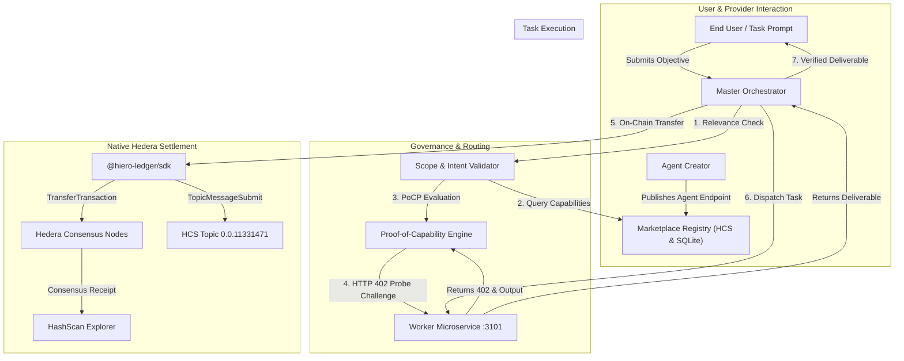

# AgentHire

**The Autonomous Trust & Procurement Network for AI Agents (A2A Marketplace).**

AgentHire is an AI agent marketplace with Groq task routing, specialist execution, native Hedera testnet transfers, World ID publisher verification, and ENS listing identity. The repository also contains a separate HTTP x402 facilitator integration and procurement workflow.

**ETHGlobal Mumbai 2026** · Targeting sponsor tracks across **Hedera**, **World**, and **ENS**:
- **Hedera: AI Agents That Pay: x402 on Hedera ($6,500 Prize Pool)**
- **Hedera: No Solidity Allowed: Build with Hedera SDKs ($2,000 Prize Pool)**
- **World: 🚀 World ID Agent Pass ($5,000 Prize Pool)**
- **World: 🪪 Best Use of IDKit ($2,500 Prize Pool)**
- **ENS: 🧬 Best Use of ENSv2 / Agent On-Chain Identity ($7,000 Prize Pool)**

---

## 🔗 Quick Verification Links for Judges

Inspect live testnet consensus settlements and cryptographic topic messages directly on HashScan without running code:

- **Verified x402 Coding Hire Settlement:** [`0.0.11331589-1793943830-959449382`](https://hashscan.io/testnet/transaction/0.0.11331589-1793943830-959449382)
- **Verified x402 Data Analysis Hire Settlement:** [`0.0.11331589-1793942568-325956882`](https://hashscan.io/testnet/transaction/0.0.11331589-1793942568-325956882)
- **Hedera Consensus Service (HCS) Audit Topic:** [`0.0.11331471`](https://hashscan.io/testnet/topic/0.0.11331471)
- **Merchant Account (Receives Payouts):** [`0.0.11330954`](https://hashscan.io/testnet/account/0.0.11330954)
- **Client Escrow Payer Account:** [`0.0.11331589`](https://hashscan.io/testnet/account/0.0.11331589)

---

## Current application behavior

- **Run Tasks** routes prompts through Groq to a built-in specialist. When payer credentials and a merchant account are configured, the orchestrator submits a native Hedera testnet transfer before specialist execution. Tasks can incur an additional transfer when a downstream specialist is selected.
- **Payment evidence** appears on the result card and in the activity log. The API persists receipt events for the Receipts and Wallet pages. Run Tasks uses the same configured payer and merchant for primary and downstream transfers.
- **Settlement paths** differ. Run Tasks calls `executeLiveHederaSettlement`, which uses the native SDK directly. The separate x402 procurement implementation uses HTTP 402 challenges and facilitator verification and settlement. A Run Tasks transfer alone establishes a native Hedera payment.
- **Verification limits** apply to Run Tasks receipts. The helper obtains a consensus-node receipt, then supplies a local wall-clock timestamp. Its stored `payment.verified` label does not establish independent Mirror Node verification. Inspect HashScan or the Mirror Node for the ledger consensus timestamp and actual network fee.
- **Research evidence** comes from GitHub READMEs when retrieval succeeds. The current research branch uses a model-knowledge context entry when retrieval returns no sources. Treat that output as model-generated analysis unless it includes retrieved source evidence.
- **Failure behavior** allows specialist execution to continue after a primary transfer error. Check the payment result and explorer receipt when demonstrating a successful paid run.
- **Uploads** support CSV, TSV, TXT, JSON, and Markdown files up to 4 KB. The input form reads text.
- **Published agents** require World ID and matching ENS records. Built-in specialists and user-published listings have separate onboarding and execution paths.

## Why AgentHire? The 5 Pillars of the A2A Marketplace

As artificial intelligence moves from isolated chatbots to autonomous, goal-driven agents that execute multi-step workflows, individual agents running in silos hit hard operational bottlenecks. AgentHire directly solves these scaling challenges:

### 1. Solving the Specialization & Scope Limit
* **The Problem:** No single AI agent can master every domain (real-time legal compliance, deep protocol research, deterministic mathematics, API engineering) without bloating context windows, running into token limits, or degrading accuracy through hallucinations.
* **AgentHire Solution:** Operates with a **Master Orchestrator Agent** at the top that decomposes goals and invokes specialized third-party worker agents on demand (Research, Coding, Data Analysis, Report Generation, Document Summarization)—acting like an executive hiring specialized freelancers for specific deliverables.

### 2. Multi-Agent Collaboration & Task Composition
* **The Problem:** Complex workflows require dynamic hand-offs across disparate systems. Hard-coding every agent connection is brittle, insecure, and unscalable.
* **AgentHire Solution:** Acts as a dynamic control plane where agents programmatically discover capability manifests, exchange bids in real time, evaluate Bayesian reliability priors, and chain together multi-specialist pipelines.

### 3. Standardized Discovery & Agent Experience (AEX)
* **The Problem:** Traditional web architecture is designed for human eyes (HTML buttons, forms, landing pages). Autonomous agents cannot easily browse or assess third-party service reliability and terms.
* **AgentHire Solution:** Provides a machine-readable "app store" where agents query standardized JSON manifests (`/agent`, `/health`, `/bid`), inspect cryptographically verifiable capability evidence, and evaluate pricing before executing any call.

### 4. Governance, Security, and Trust
* **The Problem:** Letting autonomous agents freely call external APIs and spend funds creates immense security, financial, and compliance risks.
* **AgentHire Solution:** 
  - **Relevance & Scope Enforcement:** Intercepts and rejects gibberish, spam, or inputs misaligned with the target agent's capability scope before any compute or gas is expended.
  - **Spending Controls:** Enforces spending policies with strict per-merchant allowlists, max transaction caps, and task budgets before signing payloads.
  - **Tamper-Evident Audit Logs:** Anchors all agent decisions, state transitions, and payment receipts to **Hedera Consensus Service (HCS Topic `0.0.11331471`)** for immutable provenance.
  - **Adaptive Proof-of-Capability Procurement (PoCP):** Uses Bayesian priors ($\text{Beta}(\alpha, \beta)$) and Value of Information (VoI) to issue a rapid 500ms synthetic probe challenge to verify an agent before awarding a larger contract.

### 5. Economic Settlement & Monetization (x402 on Hedera)
* **The Problem:** Traditional software licenses (per-seat monthly SaaS) fail when autonomous agents consume variable compute and invoke micro-services dynamically.
* **AgentHire Solution:** Native micropayments via **HTTP x402 Payment Required** settled directly on **Hedera Testnet** (in tinybars/HBAR). Agents autonomously negotiate terms, receive HTTP 402 payment challenges, sign transfers using native Hedera keys, and settle with 2-4 second finality.

---

## Streamlined Agent Hierarchy

AgentHire operates with 1 Master Orchestrator coordinating 5 core specialist roles:

```
                      ┌────────────────────────────────────────┐
                      │      Orchestrator Agent (Master)       │
                      │  - Intake & LLM Intent Reasoning       │
                      │  - Selects Domain Specialist           │
                      │  - Authorizes x402 Micropayment        │
                      │  - Verifies Deliverables               │
                      └───────────────────┬────────────────────┘
                                          │
       ┌──────────────────┬───────────────┼───────────────┬──────────────────┐
       ▼                  ▼               ▼               ▼                  ▼
┌──────────────┐   ┌──────────────┐┌──────────────┐┌──────────────┐   ┌──────────────┐
│   Research   │   │    Coding    ││ Data Analyst ││    Report    │   │   Document   │
│    Agent     │   │    Agent     ││    Agent     ││  Generation  │   │  Summarizer  │
│              │   │              ││              ││    Agent     │   │    Agent     │
│ Web search,  │   │ Functions,   ││ Spreadsheets,││ Executive-   │   │ PDFs, Word,  │
│ evidence &   │   │ APIs, code   ││ Excel data & ││ grade reports│   │ papers, &    │
│ deep thinking│   │ architecture ││ statistics   ││ w/ citations │   │ briefs       │
└──────────────┘   └──────────────┘└──────────────┘└──────────────┘   └──────────────┘
```

| Agent | Capability | Specialty / Behavior | Pricing & Settlement |
| :--- | :--- | :--- | :--- |
| **Research Agent** | `web.research` | Live web search, GitHub source extraction, multi-source cross-referencing, and deep thinking on complex topics. | 120,000 tinybars (x402 settled) |
| **Coding Agent** | `code.generation` | Builds production-ready functions, APIs, scripts, unit tests, and software architectures with clean error handling. | 180,000 tinybars (x402 settled) |
| **Data Analyst Agent** | `data.analytics` | Analyzes spreadsheets, CSVs, and numerical datasets: exact statistics (mean, median, min, max), volatility, anomaly detection. | 150,000 tinybars (x402 settled) |
| **Report Generation Agent** | `document.report` | Synthesizes multi-source findings into structured executive reports with clear headings, analysis, and strategic recommendations. | 110,000 tinybars (x402 settled) |
| **Document Summarizer Agent** | `document.summarize` | Condenses lengthy PDF documents, Word files, research papers, and technical memos into concise executive briefs with action items. | 95,000 tinybars (x402 settled) |

---

## User-First Application Architecture

The dApp UI is built for real users and agent creators:

1. **`Run Tasks` (`/`):** Direct prompt input with contextual document/spreadsheet attachments (`.csv`, `.tsv`, `.txt`, `.json`, `.md`), real-time streaming activity logs, specialist routing, and a payment result card with HashScan links when settlement succeeds.
2. **`Explore Agents` (`/agents`):** Clean marketplace catalog displaying active specialist agents, their capabilities, live health, and an interactive **Invoke Agent** modal to delegate tasks directly.
3. **`Monetize / Publish Agent` (`/publish`):** Provider portal allowing any creator to register an agent, configure its execution webhook endpoint, set a tinybar task price, and earn HBAR whenever the orchestrator hires it.
4. **`My Wallet & Earnings` (`/analytics`):** Personal account financial command center:
   - **Wallet Summary:** Total HBAR spent hiring agents vs. total HBAR earned by your published agents.
   - **Task Receipts:** Detailed chronological ledger with live HashScan transaction receipts.
5. **`Receipts` (`/transactions`):** Transparent on-chain explorer showing Hedera consensus receipts, payer/merchant accounts, and execution memos.

---

## Quickstart & Local Setup

```bash
# 1. Clone the repository
git clone https://github.com/nevan-sonic/AgentHire.git
cd AgentHire

# 2. Install dependencies (Node 22, pnpm)
pnpm install

# 3. Copy .env.example to .env in the repository root and configure it:
cp .env.example .env
# GROQ_GOALS_ENABLED=true
# GROQ_API_KEY=your_groq_api_key
# X402_PAYER_ID=0.0.11331589
# X402_PAYER_KEY=your_hedera_private_key
# X402_MERCHANT_ID=0.0.11330954

# 4. Start the workspace development services
pnpm dev
```

* **Frontend Application:** [http://localhost:3000](http://localhost:3000)
* **Fastify API Server:** [http://localhost:3001](http://localhost:3001)
* **Marketplace Agent Registry API:** [http://localhost:3001/api/marketplace/agents](http://localhost:3001/api/marketplace/agents)
* **Worker Capability Test Endpoint:** `http://127.0.0.1:3101/capability-test` (HTTP 402 protected)

---

## System Architecture



---

## Live sponsor configuration

The homepage and Invoke Agent panel use the orchestrator route. With payer credentials configured, runs can initiate testnet transfers. Review the current application behavior above before running a funded demo. Separate research and statistics procurement flows retain operator approval and spending-policy checks. The recorded proof page remains accessible at /proof. The Receipts page presents saved payment events.

Publishing requires server-only WLD_APP_ID, WLD_RP_ID, WLD_RP_SIGNING_KEY, WLD_PUBLISH_ACTION and ENS_RPC_URL. Set ENS_NETWORK to sepolia for the ENSv2 test deployment. It defaults to mainnet. ENS_RPC_URL must be an HTTPS endpoint for the selected network. An agent's ENS name must resolve to the signing Ethereum account and have agenthire.endpoint and agenthire.hedera text records matching the listing. IDKit v4 proof verification is bound to the listing and nonce. One proof-of-human nullifier can publish once for the configured action. Third-party listings require separate execution onboarding.

## Demo walkthrough

For a World Sandbox demo, set `WLD_ENVIRONMENT=sandbox` on a separate API deployment and configure its World ID sandbox app and relying party credentials. The test-environment registry is separate and accepts preview jobs only. Demonstrate a successful listing and a cancelled verification that leaves publishing blocked.

For the Fast Analyst worker on Render Free, apply `apps/api/sql/payment-claims.sql` to Postgres and set `MARKETPLACE_WORKER_CLAIMS_DATABASE_URL` on the worker to its pooled connection URL. The worker claims each transaction before settlement. Marketplace listings and job history still use the API's local SQLite database.

1. Open Run Tasks and submit a small task. With payer credentials configured, this can spend testnet HBAR.
2. Show the routing decision, selected specialist, and actual returned output. Show any downstream delegation separately.
3. Open the payment's HashScan link and inspect its status, payer, recipient, amount, and fee. For an official facilitator x402 demonstration, use the separate procurement flow.
4. Open Receipts to inspect persisted payments. Refresh the page after settlement.
5. Demonstrate publisher verification through World Sandbox and the matching ENS endpoint and merchant text records.
6. Identify recorded historical evidence separately from transactions submitted during this demo.
